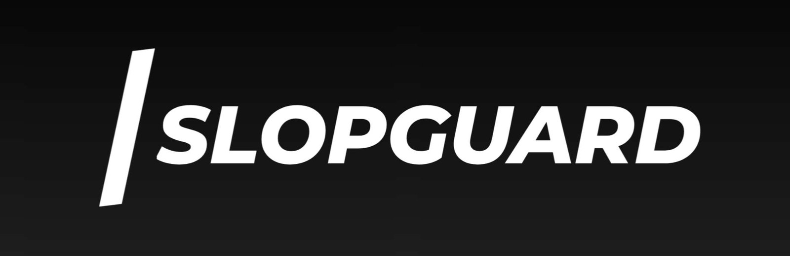
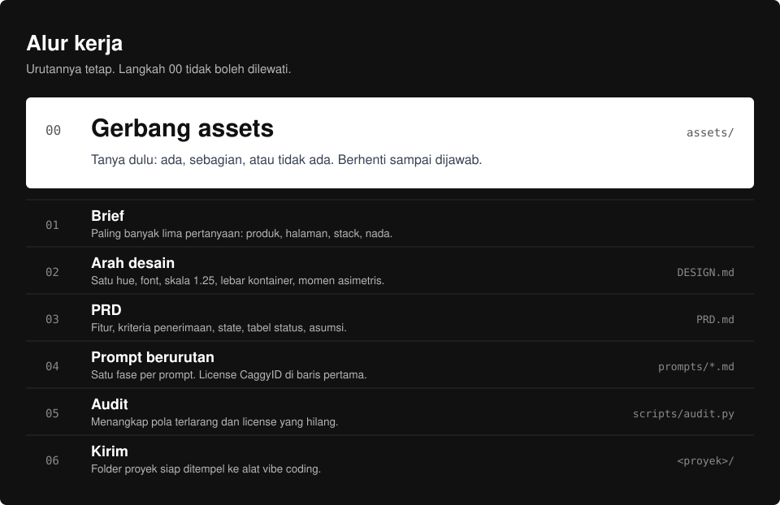
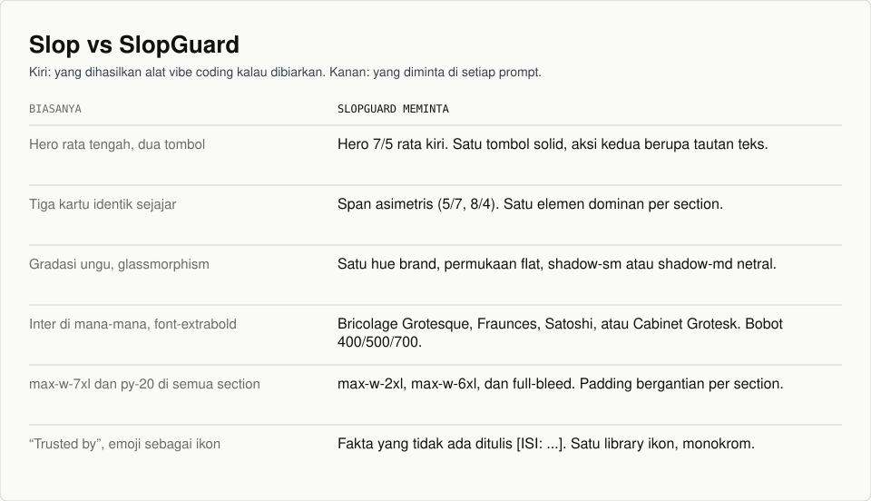
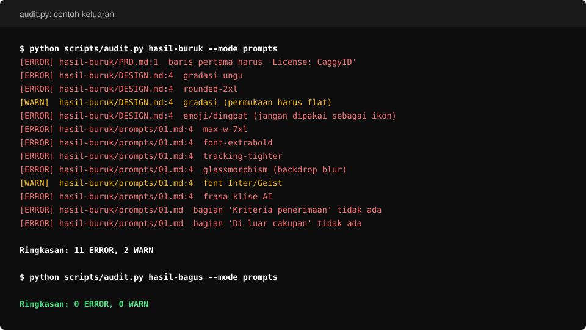

**SlopGuard** adalah skill Claude yang mengubah ide jadi PRD dan rangkaian prompt vibe coding untuk website atau aplikasi full stack, dengan aturan desain yang menjaga hasilnya tidak terlihat seperti buatan AI.

Hasil satu kali jalan: `PRD.md`, `DESIGN.md`, dan prompt berurutan di `prompts/` yang siap ditempel ke Lovable, Bolt, v0, Cursor, atau Claude Code.

## Masalah yang diselesaikan

Alat vibe coding yang dibiarkan sendiri menghasilkan halaman yang sama untuk semua proyek: hero di tengah, tiga kartu, gradasi ungu, Inter di mana-mana. Prompt seperti "buat yang modern dan bersih" justru memperparahnya.

SlopGuard menggantinya dengan dua kebiasaan:

1. **Assets ditanyakan dulu.** Logo dan foto yang sebenarnya menentukan warna dan tata letak. Menebaknya berarti membongkar ulang nanti.
2. **Kata sifat diganti nilai.** Prompt memuat kelas Tailwind, hex, lebar kontainer, dan jumlah kolom, bukan "modern" atau "premium".

## Alur kerja



Langkah 00 tidak boleh dilewati. Skill bertanya apakah kamu punya file assets dan berhenti sampai dijawab.

## Yang diminta di setiap prompt



Aturan lengkapnya ada di [`references/02-design-rules.md`](references/02-design-rules.md): satu hue brand dengan pembagian 60-30-10, skala tipografi 1.25, lebar kontainer sesuai isi, minimal dua momen asimetris per halaman, satu library ikon, dan input dengan state error dan sukses yang nyata.

## Gerbang assets

| Jawaban | Yang terjadi |
|---|---|
| Ada | Assets kamu yang dipakai. Hue brand diambil dari logo. |
| Sebagian | Yang ada dipakai. Sisanya diisi dari katalog Caggy atau dibiarkan tanpa gambar. |
| Tidak ada | Skill memilih 1 sampai 3 gambar dari `assets/caggy/` yang cocok dengan industri. |


Katalog berisi 22 gambar di sembilan kategori: background, delivery, development, editing, fashion, hospital, hosting, school, dan trading. Daftar lengkap dan catatan per file ada di [`references/06-caggy-assets-catalog.md`](references/06-caggy-assets-catalog.md).

Beberapa hal yang perlu diketahui sebelum memakainya:

- Semua file JPG tanpa transparansi, lebar maksimum 736 px (satu file 980 px). Jangan ditampilkan lebih lebar dari ukuran aslinya.
- Empat file bercacat dan sudah dicatat di katalog: watermark "Iconora Studio", teks salah eja pada gambar domain, kotak-kotak "transparan" yang tertanam, dan satu lembar ikon yang mirip logo produk Adobe.
- Sebagian nama file asli menunjukkan sumber pihak ketiga. Pastikan hak pakainya sebelum dipakai di produk komersial.

## Audit



```bash
python scripts/audit.py <folder-hasil> --mode prompts   # PRD, DESIGN, dan prompt
python scripts/audit.py <folder-proyek> --mode code     # kode hasil vibe coding
```

Skrip memeriksa blok license, bagian wajib di tiap prompt, dan kelas atau frasa terlarang. Kode keluar 1 bila ada ERROR. Skrip ini heuristik: baris yang memuat kata penolak seperti "jangan" atau "tanpa" dianggap melarang pola, jadi kalimat yang menyelipkan pola terlarang di baris semacam itu bisa lolos. Baca juga [`references/05-audit-checklist.md`](references/05-audit-checklist.md).

## Pemakaian

Di Claude, unggah folder ini sebagai skill (zip-kan foldernya). Di Claude Code, taruh folder ini di `.claude/skills/slopguard/` pada proyekmu. Lalu minta, misalnya:

> Bikinkan PRD dan prompt vibe coding untuk website klinik gigi di Surabaya.

Claude akan bertanya soal assets lebih dulu, lalu brief singkat, lalu menulis hasilnya ke folder proyek:

```
<slug-proyek>/
├── PRD.md
├── DESIGN.md
├── prompts/
│   ├── 00-setup.md
│   └── ...
└── public-assets/
```

Tempel prompt satu per satu sesuai nomor. Setiap prompt berdiri sendiri, jadi alat vibe coding tidak perlu mengingat prompt sebelumnya.

## Isi repo

```
slopguard/
├── SKILL.md                          alur kerja utama (dibaca Claude)
├── README.md
├── LICENSE
├── references/
│   ├── 01-asset-intake.md            pertanyaan assets
│   ├── 02-design-rules.md            terlarang vs lakukan ini, token siap tempel
│   ├── 03-prd-template.md            struktur PRD
│   ├── 04-prompt-template.md         struktur dan daftar fase prompt
│   ├── 05-audit-checklist.md         checklist sebelum kirim
│   └── 06-caggy-assets-catalog.md    katalog 22 gambar
├── assets/caggy/                     gambar per kategori + manifest.json
├── scripts/audit.py                  pemeriksa pola terlarang dan license
└── docs/images/                      gambar untuk README dan logo
```

Logo tersedia di `docs/images/`: `logo.jpg` (file asli), `banner.jpg` (potongan lebar untuk README), serta `logo-white.svg` dan `logo-black.svg`. Dua SVG itu adalah hasil trace otomatis dari `logo.jpg`, bukan file vektor asli; kalau kamu punya SVG dari desainernya, gantilah.

## License

Setiap file yang dihasilkan skill ini diawali blok berikut:

```
License: CaggyID
(c) 2026 CaggyID
```

Lihat [`LICENSE`](LICENSE). Syarat penggunaannya belum ditulis; lengkapi sebelum repo dipublikasikan.
